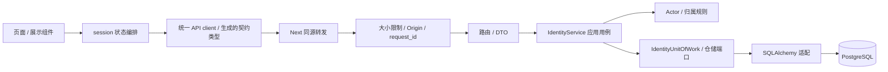

# P0 分层与数据流

P0 是模块化单体基础工程，唯一真实业务用例为匿名身份基础能力。后续业务只有模块边界和基线表，无假成功 API、任务处理或内容推荐。

## 请求与事务

Bootstrap 在一个工作单元中查找 token hash；有效则复用，否则创建 256 位随机凭证及 actor。commit 成功才返回内部 SessionResult，API 映射 DTO 并设置 Cookie。数据库读取时间统一转 UTC，避免数据库会话时区影响 HTTP Cookie。

撤销先解析服务端 actor，再验证绑定凭证的 CSRF，最后通过工作单元更新 revoked_at。仓储不提交事务，退出工作单元回滚剩余事务并关闭连接。Cookie 只在服务端提交成功后修改。

资源模块未来通过 ActorResolver 与 AuthorizationPort 授权：资源模块自己查 owner_id，身份模块不读取业务私表。不存在与他人资源统一 NOT_FOUND。P0 用夹具验证此规则，不实现会话 API。

## 依赖规则

- API 仅依赖应用服务/端口与 HTTP DTO；不导入 ORM 或第三方 SDK。
- application 依赖 domain/端口；domain 不依赖 FastAPI、SQLAlchemy 或 HTTP 客户端。
- infrastructure 实现端口，bootstrap 是集中装配点；共享基础设施不拥有业务表。
- 每个模块 infrastructure/models.py 拥有其元数据。migration/test 专用 registry 汇总全部元数据；运行时业务禁止导入 registry。
- content.explorations / exploration_answers 归 exploration；其他 content 表归 content。跨模块引用保留 DDL，不由 FK 推导运行时访问权限。
- discussion 与 conversation 不依赖 reading/catalog/handoff。架构测试检查导入方向。

## 数据契约与迁移

外部 HTTP 基线不变。P0 实际启用 4 个 operation；契约测试比较路径、operationId、响应、参数、security 和 DTO schema，并验证实际响应。前端类型由完整 OpenAPI 生成，生成类型不等于实现未来接口。

18 张表由冻结的 Alembic 初始迁移创建，不在运行时读取 db/schema.sql 或调用 create_all。测试通过 PostgreSQL SQL AST 比较冻结迁移与设计 DDL，并用数据库反射核对 ORM 元数据；约束用非法插入和重复写入验证。

## 安全及运行边界

- Cookie 固定 Secure/HttpOnly/SameSite=Lax/Path=/；默认本地 localhost。写请求要求精确 Origin，bootstrap 免 CSRF；DELETE 要求 X-CSRF-Token。
- CSRF 有随机量、签名、时间与凭证绑定；1 小时到期，旧 token 在有效期内保持可用。身份开发默认 7 天，不等同于生产数据保留政策。
- 请求实际流量硬限 64 KiB，包括无 Content-Length 的请求；超限 422 INVALID_INPUT，遵循现有错误响应契约。
- API 日志只记录生成的 request_id、路由模板、状态、耗时；未知路由不记录原始 path/query。uvicorn 关闭原始 access log。
- ready 检查数据库和迁移 head；live 不检查外部依赖。Worker 同仓库独立进程，每 30 秒检查就绪并支持信号退出，未注册业务 handler。
- LLM/Search 默认 Mock，测试输入可注入；结构化结果严格验证，错误/超时可注入；不会产生“已核验”的假书籍资料。
- 开发 Compose 隔离数据库端口，生成随机本地配置。P0 不提供生产部署方案、真实内容审核引擎或业务配额；这些随对应业务阶段落实。

参考：Next 同源转发使用官方 rewrites 配置：https://nextjs.org/docs/app/api-reference/config/next-config-js/rewrites 。
