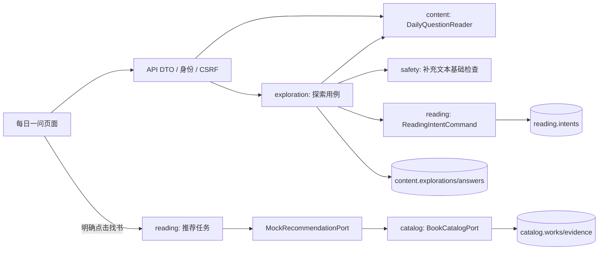

# P1 每日一问的数据流与维护

## 实现范围

P1 实现选项加可选文字补充的短探索，以固定样例演示推荐。真实模型语义理解、联网检索、生产推荐 Worker 留在 P2；独立思辨不参与本链路。



每张表只由 Owner 读写。探索只从内容端口读取已校验的版本快照。目录模块不读取用户选择或私密补充，仅接收主题标签。API 不直接使用仓储。

## 版本、状态与恢复

每日题按 Asia/Shanghai 选取已发布排期；缺失或撤下时使用已审核、已发布备用题。每次探索固定版本，维护脚本拒绝覆盖既有版本；内容变更新建版本。题目流程 JSON 包含 schema_version=1，校验环路、终点、2—3步长度及可选步骤的 skip 选项。

同一步相同归一化答案为幂等重试，不同内容返回409。到达流程终点后先保留答案，再按来源幂等建立意图，最后关联完成；网络/服务失败后重提最后一步或点击“恢复阅读方向”，不会丢失答案、重复建立意图。

返回改答创建同版本新探索；前端仅在 sessionStorage 保存探索/任务 ID、题目公开标题和改答来源 ID/索引，补充原文不写入浏览器持久存储。刷新后由授权接口恢复答案。前缀重放失败时保留重放元数据，可刷新重试。

已完成探索、意图、任务结果不受新探索影响。最后的推荐 POST 必须由用户点击触发，202 保持既有任务响应。P1 Mock 可以在请求内同步推进固定结果，但仍使用持久任务和 GET 查询；不承诺生产任务恢复，P2 再实现租约/重试 Worker。

## 字段、迁移与安全

ADR-012 增加 supplementary_text（300字符、空白归一null）和 answers 恢复记录。记录中的 step_prompt/option_label 为只读展示字段，提交只接受 step_id、option_id、supplementary_text。ReadingIntentV1 维持原字段与 schema_version=1；focus 是选项含义和补充原文的有界整理，不宣称 AI 语义理解或人格判断。

Alembic 0002 在 0001 上增加可空补充列和 daily_question 来源部分唯一索引；原始0001保持不变。设计DDL同步供参考，不另行执行。ready 的迁移检查同步到0002。

归属与 CSRF 复用 P0，React 以纯文本渲染补充；日志不记录原文。P1 提供有限的确定性高风险输入门禁，可注入替换；它不是完整生产内容审核系统，后续必须补充风险覆盖、限流和运营流程。

## 本地运行和内容准备

Compose 的 migrate 服务执行迁移后，通过私有维护 CLI 幂等导入未来7天排期、备用题和少量核验样例：

```text
alembic -c backend/alembic.ini upgrade head
python -m app.bootstrap.seed_daily
# 也可固定排期起点
python -m app.bootstrap.seed_daily --start-date 2026-10-27
# 明确将新内容版本发布到所选7天排期；旧探索仍引用原版本
python -m app.bootstrap.seed_daily --start-date 2026-10-27 --publish-current-version
```

重复执行不覆盖已有排期或题目；已有题目内容与脚本不一致时拒绝并要求创建新版本。维护动作不开放公共HTTP接口。自动化测试只连接名称以_test结尾的隔离空库。

当前种子内容版本为2，第一步使用对应题目的具体立场标签。默认不覆盖已有排期；已有版本1环境可由维护者使用 --publish-current-version 明确更新排期，版本1记录和已进行的探索不变。

## 固定样例的事实依据

2026-10-27 实际访问以下 Project Gutenberg 书目页，核对作者、作品标题和编目主题。页面自动生成的概要不作为未经核验的情节依据；样例介绍仅用简短的类别与主题描述。没有转载全文、译文或原著引文，不把美国公版标记等同于全球授权，不提供未经确认的中文译本信息或封面。

| 样例 | 来源 | 样例方向 |
|---|---|---|
| 瓦尔登湖 / Henry David Thoreau | https://www.gutenberg.org/ebooks/205 | 独处、自然、生活方式；来源条目含 Walden 和另一篇文章，不将另一篇文章当独立推荐 |
| 简·爱 / Charlotte Brontë | https://www.gutenberg.org/ebooks/1260 | 成长与爱情，依据作者/标题和 love stories/bildungsroman 编目 |
| 理想国 / Plato | https://www.gutenberg.org/ebooks/1497 | 正义，依据作者/标题及 justice/political science 编目 |

仅对这些实际核验的固定资料导入 verified 证据，明确检查时间和180天有效期；过期或证据不可用即不进入样例结果。此记录不承诺具体中译本、人物情节或版权授权。
