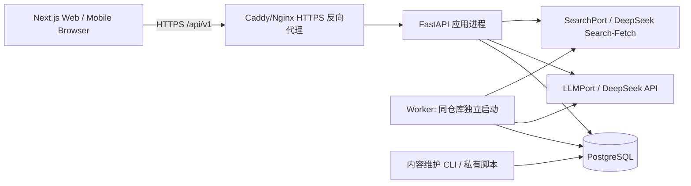

# 问与书 · 软件架构设计文档（SAD）

- 版本：1.0（Codex 实施基线）
- 日期：2026-10-24
- 输入：已确认的《问与书》PRD V1.2、业务架构 V0.4 和思辨架构修订 V0.2–V0.4
- 范围：中国大陆首发、Web 优先、18+、免费 MVP；未来 Android 和大师对话可扩展
- 状态：**实现规范/设计基线，不等于已部署或已完成监管程序**
- 优先级：法律及数据安全硬性要求 > PRD 用户行为 > 本 SAD 系统边界与接口 > 实施任务说明 > 临时代码注释。若冲突先在 PR 提出 ADR，不自行修改合同。

## 0. 实施者使用说明

**交给 Codex 的至少四个输入**：`docs/PRD.md`（从已确认 PRD V1.2 另存）、`docs/SAD.md`（本文件）、`contracts/openapi.yaml`、`db/schema.sql`。同时提供 `docs/DELIVERY.md`、根目录 `AGENTS.md`。Codex 每次**仅实施一个阶段/一个 PR**；每阶段必须通过自动化测试和手工验收后才能进入下阶段。

**文件职责**：
- `contracts/openapi.yaml` 为外部 HTTP API 的结构化契约基线；约定字段修改须同步契约、服务实现、前端类型、测试。
- `db/schema.sql` 为 PostgreSQL 逻辑建表参考；正式项目由 Alembic 迁移生成并校验与之等价，**不能将此文件与 Alembic 两条迁移路线同时运行**。
- 本文说明模块规则、时序、状态机、NFR、运维部署与长期演进。
- `docs/DELIVERY.md` 约束 Git、PR、阶段验收和发布。
- `AGENTS.md` 是 Codex 的项目执行约束。

## 1. 范围、关键决策与非目标

### 1.1 决策

| ADR | 决定 | 原因 |
|---|---|---|
| ADR-001 | 模块化单体 FastAPI，模块内部 API/Application/Domain/Infrastructure 分层 | 一人/小团队易开发、易测试、后续可分离 |
| ADR-002 | Next.js + TypeScript Web；后续 Android 消费同一 `/api/v1` | 避免二次实现业务 |
| ADR-003 | PostgreSQL 单主库；schema 按模块分隔 | FK/UNIQUE/CHECK/事务和 JSONB；降低运维 |
| ADR-004 | DeepSeek 为首发 LLM，经 `LLMPort` 适配 | 可替换；模型名配置化；密钥仅在服务端 |
| ADR-005 | 推荐优先使用模型已有知识；高风险/待核验事实走 Search/Fetch | 不建立完整图书库，但不能将模型自信视作证据 |
| ADR-006 | 通用 ConversationRuntime + 独立 DiscussionPolicy | 未来 MasterDialoguePolicy 可扩展；现在不建大师模块 |
| ADR-007 | 思辨主流程只提供对话；阅读联动通过独立 Handoff 模块由用户触发 | 业务解耦/故障隔离/最少数据共享 |
| ADR-008 | Redis、微服务、LangGraph、Mem0、向量库、支付、社区均不入 MVP | 避免过早扩张 |
| ADR-009 | 统一匿名会话身份、限流、访问控制和内容举报 | MVP 无登录也必须防串话、防滥用 |
| ADR-010 | 推荐与阅读联动采用数据库持久化任务 + 进程内/独立 Worker（同代码库） | 慢调用不阻塞 API；可恢复与幂等 |

### 1.2 非目标

不实施 Android 客户端、不支持未成年人、不实现大师对话、不存私密跨会话人格画像、不提供电子书全文/未经授权的金句、无公开 UGC、无付款。不得为这些未来模块预造表和接口。

## 2. C4 风格的逻辑/部署视图

**物理部署（生产）**：中国大陆合规接入的 Web/反向代理 + 单一 FastAPI 服务 + 同代码库的 Worker 进程 + 托管 PostgreSQL（私网访问）。域名备案、合规资质、网络安全、个人信息与生成式 AI 适用手续为**上线前法律门禁**；不得以技术完工代替主管部门要求。静态资源由 Web 提供；数据库绝不开放公网入站；所有 API Key 只通过服务端密钥配置。

**开发部署**：`web`、`api`、`worker`、`postgres` 由 `docker compose` 可启动；AI/Search 提供 Mock 实现。Postgres 持久卷、本地环境变量 `.env.example`（无真实密钥），配置项清晰；生产不使用开发默认密码。

## 3. 业务模块边界与禁止依赖

| 模块（Owner） | 内部负责 | 对外公开端口 | 禁止直接访问 |
|---|---|---|---|
| `content` | topics/questions/version/daily_schedule | `TopicReader`, `DailyQuestionReader` | conversation/recommendation 私表 |
| `exploration` | 选项流程校验/状态/答案 | `ExplorationCommand`, `ExplorationRead` | conversation 消息表；模型 Key |
| `reading` | ReadingIntent、推荐任务/结果、排序、审核 | `ReadingIntentCommand`, `RecommendationPort` | discussion 私有消息/前端页面状态 |
| `catalog` | works/editions/evidence、核验缓存 | `BookCatalogPort`, `EvidenceReader` | discussion 会话 |
| `conversation` | 会话、消息、状态、最近历史、摘要、SSE | `ConversationRuntime`, `ConversationSnapshotReader` | 推荐、书目 |
| `discussion` | 议题上下文、DiscussionPolicy、回答策略 | `DiscussionDialoguePolicy` | catalog/reading |
| `handoff` | 授权快照→阅读意图→推荐任务，快照钉住序号 | `ReadingHandoffPort` | 任何其他模块私有表 |
| `identity` | 匿名凭据/访问身份 | `ActorResolver`, `AuthorizationPort` | 业务字段 |
| `safety` | 输入输出政策、举报、审计元数据 | `SafetyPort`, `ReportPort` | 无需读取全部历史 |

### 3.1 强制依赖规则

1. **Controller 不访问 ORM/第三方 SDK**；Controller 只做 auth、Pydantic 校验、应用用例调用、输出映射。
2. **Domain 不依赖 HTTP/ORM/DeepSeek**；应用层定义 `LLMPort`、`SearchPort`、`ConversationSnapshotReader` 等接口，infra 实现它们。
3. **每张数据表有唯一 Owner**，其他模块不得 `SELECT/UPDATE` 其私有表；共享实体通过受控端口/DTO 访问。单库不等于随意 join。
4. **跨模块写入由应用协调器执行**（例如完成探索后调用 ReadingIntentCommand）；失败保证可重试，不要求分布式事务。
5. 内容来源中的网页文本、用户输入和检索结果视为不可信数据，不允许覆盖系统指令、查询本地密钥或强制执行工具调用。
6. 不可引入循环依赖；`conversation` 和 `reading` 都**不能**依赖 `handoff`；`handoff` 依赖它们的读取/命令端口。

### 3.2 核心数据契约

- `ReadingIntentV1`: `source_type` (`daily_question|direct_search|discussion`), `purpose` (`interest|learning|exploration`), `central_question?`, `topics[]`, `focus?`, `preferences{genre?,style[],difficulty?,language}`, `schema_version=1`。`source_ref_id` 仅用于溯源，不访问源模块私表。
- `DiscussionSnapshotV1`: `conversation_id`, `up_to_seq`, `topic_id?`, `topic_title?`, `messages[]`, `summary?`, `snapshot_version=1`；**仅由授权只读端口提供**。
- `RecommendationResultV1`: `job_id`, `status`, `items[]`，每条有 `work_id,title,author,summary,reason,verification_status,evidence_urls[]`。`verified` 必须有可定位的证据；不得将仅模型知识标记为外部核验。
- API 外部 schema 以 `contracts/openapi.yaml` 为准，内部 DTO 通过 Pydantic 模型版本控制；数据库行结构不直接作为响应 DTO。

## 4. 主业务数据流

### 4.1 每日一问→书单

**P1 补充（ADR-012，用户批准 2026-10-27）**：探索采用选项加可选 supplementary_text（每步最多300字符），文字不改变 P1 题目分支。ExplorationState 返回当前身份的 answers 及用于恢复展示的题干/选项标签。改答建立同版本新探索并重放有效前缀；完成流程通过 ReadingIntentCommand 按 actor+来源幂等创建意图，再由 exploration 关联完成。P1 推荐由 MockRecommendationPort 演示，真实模型和 Search 留 P2。

1. `GET /questions/daily` 用北京时间固定当日已发布 `question_version`；不存在时使用已审核备用题（记录告警）。
2. `POST /explorations` 固定 `question_version_id`。服务端由内容快照校验选项，客户端不能自造 `topic_tag`。
3. `POST /explorations/{id}/answers` 校验合法选项、选项所属当前步骤、幂等；对话期内锁定版本。完成时内部创建 ReadingIntent，并返回 ID。
4. 用户显式点击找书：`POST /recommendations` 创建持久化任务（不直接返回模型胡编书名）。
5. Worker 生成候选→书目/内容分级核验→排名→后端审核→结果；前端轮询 `GET /recommendations/{job_id}`。

### 4.2 直接找书→书单

`POST /reading-intents` 将选择或文字转换成标准意图（有自由文本时可经 LLM 语义归纳，需限流），之后走同一 RecommendationPort。默认返回1—3本书。搜索不足就少给，不凑数。

### 4.3 独立思辨→持续讨论

**ADR-013（2026-10-27，用户批准范围修订）**：每日一问新版本改为两步选择后进入真实讨论，理由可多选。探索答案增加可选 option_ids；ConversationCreate 增加可选 exploration_id。discussion 应用协调器经探索快照端口校验归属和完成状态，再经 ConversationSessionPort 创建通用会话。discussion.contexts 唯一保存固定题目及初始选择，conversation 仅负责通用消息和摘要；API 只调用应用服务。旁栏找书只导航到预留页，未实现 Handoff 或搜索。旧题目版本与旧意图保持不变；聊天本身不创建意图或推荐任务。0003 增量迁移与 OpenAPI 同步，见 `adr/013-daily-discussion.md`。

`POST /conversations(kind=discussion)` → `POST /conversations/{id}/messages` SSE；ConversationRuntime 负责顺序、记忆、流式、安全、失败恢复。**正常讨论不调用推荐模块、不创建 ReadingIntent**。用户在前端可一直聊、不被主动导购打断。

### 4.4 用户主动点击「根据讨论找书」

`POST /reading-handoffs` 附 `conversation_id` + `up_to_seq` + 幂等键，后端再次做 actor 授权；抓取不超过该 seq 的只读快照；提炼用户关注的问题与阅读方向，尽量去标识化；创建 ReadingIntent 和 RecommendationJob；读取任务后给书单。**推荐失败不影响原对话**；新消息不能改变进行中任务的快照；快照不落全量聊天副本。

## 5. AI、搜索与记忆设计

### 5.1 LLM 与搜索适配

- `LLMPort.generate_structured(schema, messages, config)`：负责阅读意图、候选书、压缩摘要；JSON 不合法或非完成状态视为失败；用 Pydantic 严格校验。
- `LLMPort.stream_chat(messages, config)`：对话流；终止原因须确认为正常完成，不把输出被截断的内容标记完成；**不向客户端透传模型私有推理字段**。
- `SearchPort.search(query)`、`SearchPort.fetch(url)`：按需调用 DeepSeek Search/Fetch；检索文本只当证据候选，需要信源评级/版权限制与安全过滤。
- Provider model ID、超时、输出预算、搜索开关、成本上限从配置读取。初始建议 `deepseek-flash`，可依据质量评测切换 `deepseek-v4-pro`；不得假定服务商 API 永久不变。
- 正式展示关键书目信息之前，要有已核验书目来源或缓存；无书目佐证不得将模型自信度视为 `verified`。复杂故事细节只有来源支持才展示。

### 5.2 ConversationRuntime（借鉴 Codex 的历史+压缩，不搬框架）

- 持久化原始完成消息；`seq` 在一个会话内单调递增，原始记录不可因摘要覆盖。
- 组装 `system_policy(version) + topic_context + rolling_summary(covered_until_seq) + recent_messages + current_input`。
- 默认最近6—10轮作为*可调初值*，压缩依据实际 token 预算（非固定 N 轮）；若覆盖范围重叠必须按 seq 去重。
- 摘要结构保存：主问题、讨论观点、**观点变化/当前观点**、限定条件、尚未解决问题、`covered_until_seq`、版本；只归纳讨论，不推断心理人格、不跨会话累积。
- 压缩失败：保留旧摘要和原始消息；本轮缩减窗口或返回可重试错误；永不破坏当前会话。
- 断线：客户端用 `GET /messages?after_seq=` 重新获取完成消息；**MVP 不承诺按 token 原位恢复流**。
- 单会话每时刻至多一个生成轮次；并发第二条消息返回 `CONVERSATION_BUSY`；客户端稳定 `client_message_id` 幂等。
- 输出采用小批次安全检查后 SSE；禁止输出未经审核的显著高风险流片段；最终消息完整审核后标 `completed`。流中断的消息标 `failed`，不能作为已完成历史。SSE 已经发出 200 后通过 `event:error` 告知业务错误。
- 未来大师对话新增 `MasterDialoguePolicy + master_contexts`，不改原会话核心表；本版不实现。

## 6. 正式数据模型

完整 DDL 见 `db/schema.sql`，以下为业务归属和关系要求。

| Schema | 表 | 关键约束 |
|---|---|---|
| `identity` | `actors` | token **哈希**唯一；过期；服务端凭证绑定 |
| `content` | `topics`, `questions`, `question_versions`, `daily_schedules`, `explorations`, `exploration_answers` | 每日日期+用户阶段唯一；question+version 唯一；答案不能跨探索重复步骤 |
| `conversation` | `sessions`, `messages`, `summaries` | `(session_id, seq)` 唯一； `(session_id, client_message_id)` 唯一（非空时）；摘要覆盖序号 |
| `reading` | `intents`, `recommendation_jobs`, `recommendation_items` | `(actor_id,idempotency_key)` 唯一；`(job_id,rank)` 唯一；状态 CHECK |
| `catalog` | `works`, `editions`, `evidence` | 作者/书名可核验；ISBN 唯一（非空）；作品与版本分离；证据出处与到期 |
| `handoff` | `jobs` | `(actor_id,idempotency_key)` 唯一；引用快照 seq 固定；无聊天全文副本 |
| `safety` | `reports` | 反馈对象和举报原因、处理状态明确 |

**通用约束**：所有业务 ID 使用 UUID，所有时间保存为 `timestamptz` UTC（视图按北京时间展示）；数据列用 snake_case；枚举字符串用受约束的 CHECK；业务 JSONB 需要 `schema_version` 和应用层 Pydantic 验证；业务唯一性以数据库约束为最终防线；建表语句不是权限模型，代码还必须实现授权与最小权限。

**跨模块引用**：`handoff.jobs.conversation_id` / `reading_intent_id` 采取 UUID 引用，不允许 Handoff 直接 SQL join 其他模块私表。模块的 Application Port 完成权限与存在性校验。跨模块孤儿数据由清理任务和一致性测试修复。模块内使用真实 FK。

**删除与保留**：会话/用户信息采用明确保留期限（上线前需产品/法律确认，可配置），用户删除请求经归属模块删除内容、摘要、关联任务，避免遗留私密快照；安全与合规日志按法定必要保留，不得承诺绝对即时物理擦除备份。未登录身份用安全随机 Cookie + 服务端 token hash，`Secure`,`HttpOnly`,`SameSite=Lax`，写操作校验 Origin/CSRF；拒绝仅凭客户端输入 UUID 获取会话。匿名会话引导端点需要支持 **幂等 bootstrap**：浏览器已有有效 Cookie 时返回同一身份的新 CSRF token，不得因刷新或重进页面就更换身份并丢失会话；无有效 Cookie 时才创建新身份。

## 7. API 契约、错误与状态机

### 7.1 API 基础规则

- Prefix: `/api/v1`；JSON UTF-8；ISO8601 UTC 时间；UI 展示北京时间。
- 所有写操作通过绑定的匿名 Cookie/用户认证；必要位置额外接受 `Idempotency-Key`（推荐与阅读联动）。
- `request_id` 在响应头 `X-Request-ID`；错误体 `{"error":{"code":"...","message":"...","retryable":false,"request_id":"..."}}`。
- 外部 API 不暴露数据库、Key、LLM 内部推理和异常堆栈；禁止跨会话越权（应避免泄露资源存在性）。
- 列表接口采用 `limit/cursor` 或指定的 `after_seq` 增量分页，硬限制请求长度与返回规模。
- SSE: `message_started`, `message_delta`, `message_completed`, `message_error`; 客户端断线后以消息列表恢复完成记录，而不是重复扣费重跑同一轮。
- `OpenAPI` 为**外部 API Schema 完整基线**；内部模型结构不暴露为任意新 endpoint。

### 7.2 业务状态机

| 实体 | 状态/转换 | 不变量 |
|---|---|---|
| Exploration | `active -> completed|expired` | 完成/过期不可继续提交；版本固定 |
| Conversation | `active -> closed|expired` | 关闭后不可写消息；单会话最多一轮生成中 |
| Message | `pending -> generating -> completed|failed|blocked` | 只有 completed assistant 消息进入后续确认历史 |
| RecommendationJob | `pending -> processing -> succeeded|partial|failed` | 超时可恢复/有界重试；同 idempotency key 同 job |
| HandoffJob | `pending -> processing -> succeeded|partial|failed` | 固定 `up_to_seq`；失败不改变 Conversation |
| Evidence | `pending -> verified|rejected|stale` | 仅经来源核验可 verified；过期须重新核查 |

### 7.3 错误码及 HTTP 映射

| Code | HTTP | 可重试 | 触发与处理 |
|---|---|---|---|
| `INVALID_INPUT` | 422 | 否 | 参数/字段不合法；前端高亮 |
| `UNAUTHORIZED` | 401 | 否 | 会话凭证缺失/失效，重新建立身份 |
| `NOT_FOUND` | 404 | 否 | 资源不存在或越权；不泄漏归属信息 |
| `QUESTION_VERSION_CONFLICT` | 409 | 视情况 | 题目版本不匹配；恢复绑定版本或重开 |
| `INVALID_EXPLORATION_STEP` | 409 | 否 | 不合法选项/已完成探索 |
| `CONVERSATION_BUSY` | 409 | 是 | 该会话已有生成轮次，稍后提交 |
| `IDEMPOTENCY_CONFLICT` | 409 | 否 | 同幂等键却使用不同请求参数 |
| `RATE_LIMITED` | 429 | 是 | 速率超标；提供 Retry-After |
| `CONTENT_BLOCKED` | 422 | 否 | 不适宜内容；展示适当提示 |
| `MODEL_UNAVAILABLE` | 503 | 是 | 模型依赖超时/错误；保留原会话 |
| `SEARCH_UNAVAILABLE` | 503 | 是 | 搜索故障；推荐降级或重试 |
| `BOOK_VERIFICATION_FAILED` | 422 | 否 | 可靠候选不足；返回空或部分结果 |
| `SERVICE_INTERNAL_ERROR` | 500 | 视情况 | 内部错误；记录 request_id，不泄露堆栈 |

异步任务 API 创建成功返回 `202`，查询任务返回 `200` 和 `status`；失败状态包含 `error` 对象。**部分成功是业务结果 `partial`，不是 HTTP 500**。

## 8. 推荐校验门（MVP）

1. `FrameAnalyzer`：题目深层主题（如孤独→宿命/隔阂/独处/联结）与用户选项；用户明确意图优先，避免心理画像。
2. `CandidateGenerator`：DeepSeek 提出少量作品候选 + 精简理由；模型已有知识优先。
3. `VerificationGate`：结构、重复、书名作者、主题支持度、适龄和版权；触发必要的 Search/Fetch。可从“已核验缓存”复用。**未经证据核验不得写 verified**。
4. `RecommendationWriter`：仅基于支持的内容描述生成用户文案；不虚构具体角色/情节/引用。
5. `FinalGate`：Pydantic、证据关联、推荐多样性、状态审核；只返回合格条目。允许1—3本、`partial`；0本返回 failed（不伪造）。
6. 无需 LangGraph：由常规后端代码依序组织。搜索工具由后端主动控制、只读、限频、限域/可信来源、超时有界。

## 9. 安全、隐私与运行质量

- 默认只面向成年人；不通过 UI 文案替代适龄访问控制。法定上线前资质/手续由运营主体按要求完成。
- 用户消息、模型回复在入库/展示前经过内容安全策略；必要的 AI 标识及举报渠道。
- `Report` 支持 `message`/`recommendation` 举报，并可以由运营人员处理（MVP 可后台脚本）。
- 限制每条用户输入、探索请求、模型输出和每个匿名身份每日调用量；全局成本预算开关。
- 接口跨域白名单、CSP、安全响应头、TLS、数据库私网、服务端密钥；搜索结果作为不可信内容对待。
- Observability：每次请求 `request_id`、`job_id`、`conversation_id` 可关联；记录耗时、token 消耗、失败阶段、模型版本，不默认采集完整私密对话到日志。
- 建议**初始而非承诺**SLO：静态内容 p95 < 500ms（排除公网）、首个聊天可见内容目标 < 5s（模型依赖条件下）、推荐任务目标 < 30s；发布前实测并调整。不可凭空宣称已达标。
- 数据库备份定期演练恢复；迁移采用先向后兼容（expand → migrate → contract），发布具备回滚包与数据库恢复方案。**数据库迁移不保证能一键逆转**。

## 10. Worker 可靠性（不引入消息队列）

- `recommendation_jobs` 与 `handoff.jobs` 持久化排队；一个独立启动的 Worker 进程通过 `FOR UPDATE SKIP LOCKED` 原子领取可执行任务、更新租约 `lease_until`、维护 `attempts`。
- Worker 进程崩溃后租约超时可重新领取；所有步骤幂等；`max_attempts` 限制反复调用，外部操作无付款等不可逆副作用。
- `POST` 创建 job 事务提交后即可被 Worker 领取；不依赖 FastAPI `BackgroundTasks` 保证持久任务交付。
- Handoff 的跨模块流程分步保存关联 ID，重试不生成重复意图/书单；并发任务状态更新采用条件更新或事务锁。
- Worker 不应每秒无界轮询，使用指数退避/配置化轮询间隔；开发可直接 Mock 并同步推进，生产以持久任务为准。

## 11. Git、质量门禁与分阶段落地

完整规范 `docs/DELIVERY.md`。通用循环：

`feature branch -> 单阶段变更 -> 本地测试 -> PR -> CI -> 人工产品验收 -> merge main -> tag milestone -> 进入下一阶段`。

建议 `main` 保护、要求 CI 成功，禁止强推；个人开发者可自己审 PR，但不能省略自动化验证与人工验收。GitHub branch protection 能配置 PR 与状态检查门禁（是否可用依账户/仓库类型而定）。

**上线最终门禁**：通过全部功能验收并不等于可对外提供服务；仍须确认 ICP/公安联网等适用备案、AI 服务相关手续、个人信息/内容/版权和安全要求。

## 12. 验收矩阵（系统级）

- 架构：Discussion 无 Recommendation 依赖；替换 LLM/Search Mock 不改 API；OpenAPI 与实际路径一致。
- 每日问题：时区切换、内容缺失备选、版本中途更改、重复回答和非法选项。
- 推荐：DeepSeek 离线 Mock、JSON 非法、来源缺失、书目同名、两本 partial、0本失败、模型/搜索超时、重复请求。
- 对话：长讨论滚动摘要、观点变化、断线后读取、输入/输出风险、并发 `CONVERSATION_BUSY`、不同 actor 越权。
- Handoff：不点击永不调用推荐；点击时固定快照；聊天继续，推荐失败不影响会话；重复点击幂等。
- 数据：Alembic upgrade 能在空库执行；约束在实际 PostgreSQL 生效；删除匿名身份/会话后的数据清理符合政策。
- 发布：生产配置没有开发默认密钥，备份/恢复演练，外部依赖故障、日志脱敏、成本开关、合法上线资质核验。

## 13. 变更控制

冻结的是**契约和业务边界**，不是永远不许改变任何代码。变更 API/字段/模型策略前：
1. 写 ADR (`docs/adr/NNN-topic.md`)：问题、备选、选择、影响与回滚。
2. 在同一个 PR 中同步修改 `docs/SAD.md`、OpenAPI、数据库迁移、前后端 DTO 和测试。
3. 若破坏 API 兼容性，新增版本路由或提供迁移过渡，不能静默改返回字段。
4. Git 按阶段 tag 记录可恢复基线；未经验收不得标记里程碑完成。

## 14. 官方参考链接（2026-10-24 核验）

- DeepSeek Chat Completions: https://api-docs.deepseek.com/api/create-chat-completion/
- DeepSeek Search/Fetch: https://api-docs.deepseek.com/zh-cn/guides/search/
- DeepSeek model list: https://api-docs.deepseek.com/zh-cn/api/list-models/
- GitHub branch protection: https://docs.github.com/en/repositories/configuring-branches-and-merges-in-your-repository/managing-protected-branches/about-protected-branches

**本文不构成自动许可或法律意见。上线主体与服务实际功能决定适用手续。**
