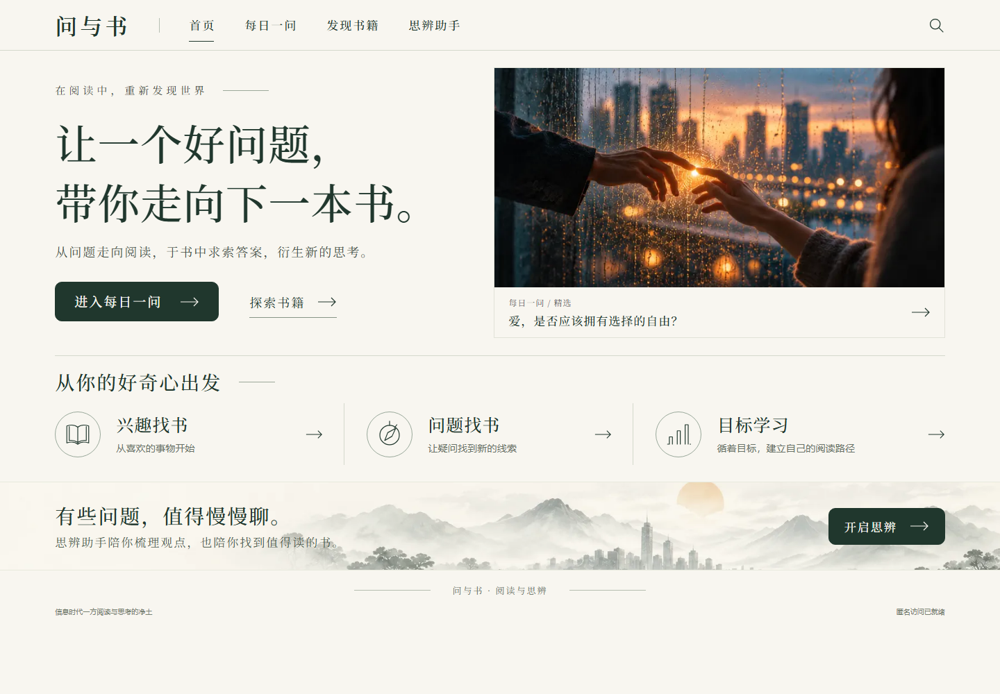
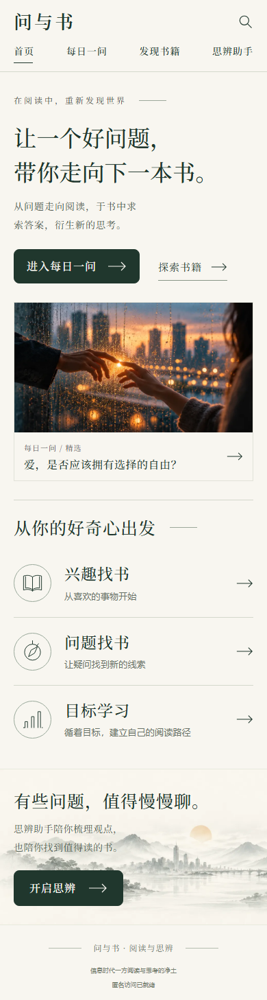

# 首页视觉重构 · 问与书 V1

日期：2026-10-27。范围：现有 P1 的前端视觉与路由整理，不进入后续业务阶段。分支 `codex/home-visual-v1`，从 `bfc8965d570257ffaf902fbf3f29d9831d9c9c90` 创建；PR及最终提交SHA见交付回复和Git历史。

P1 PR #3 仍未合并，因此本视觉PR以 `feat/p1-daily-exploration` 为基线，便于只审查本次前端差异。没有向 main 开发或合并。用户已明确确认：本轮只完成首页，滑动式每日一问留下一步。

## 实现与边界

- 首页保留真实HTML品牌、四项导航、标题、标语和按钮；左侧文案，右侧爱情主题精选预览，下面是三种找书入口及独立思辨引导区。
- 统一宣纸白、松墨绿、细线分隔、低饱和水墨背景；中文标题使用本地宋体类字体，正文使用系统中文无衬线字体，无在线字体或大型UI/动画依赖。
- 组件提取为 SiteHeader、SiteFooter、HomeHero、FeaturedQuestion、BookDiscoveryEntry、ThinkingAssistantEntry及统一线条SVG图标。组件复用现有色彩变量和匿名访问状态。
- 已有 DailyExplorer 原样移到独立前端路由，没有改变其答案、状态机、对话、数据存储或后端调用。旧哈希链接兼容跳转；书籍预留页返回原讨论的入口同步更新。
- 图片是独立素材，未把整张设计稿用作页面背景；所有文字、导航和按钮均可独立选择、聚焦与操作。素材通过内置imagegen基于用户参考图重建并压缩为WebP，非原参考图的逐像素裁剪，提示词及路径见[素材记录](HOME_VISUAL_V1_ASSETS.md)。

本次没有修改 PRD、SAD、FastAPI、数据库、OpenAPI、服务端配置或迁移。真实后端继续运行；本机端到端测试使用独立Mock API端口8100，通过浏览器测试夹具转发，不消耗DeepSeek调用，结束后停止该测试进程。

## 导航去向及未完成事项

| 入口 | 去向 | 状态 |
|---|---|---|
| 首页导航 | `/` | 新首页 |
| 每日一问、主按钮、精选预览 | `/daily-question` | 现有选项探索及AI讨论；本轮没有纵向滑动 |
| 旧每日一问书签 | `/#daily-question` → `/daily-question` | 兼容跳转，不清除身份或sessionStorage |
| 探索书籍、发现书籍、搜索图标 | `/discover` | 明确准备中，不提供搜索表单或假书单 |
| 兴趣找书 | `/discover?mode=interest` | 对应模式的准备页 |
| 问题找书 | `/discover?mode=question` | 对应模式的准备页 |
| 目标学习 | `/discover?mode=learning` | 对应模式的准备页 |
| 开启思辨、思辨助手导航 | `/discussion` | 独立思辨页尚未实现，明确标识并链接现有每日一问讨论 |
| 原推荐预留页 | `/recommendations` | 保留；返回入口指向独立每日一问 |

三个找书模式及独立思辨业务仍需后续阶段开发。本次仅建立诚实、可操作的前端入口，不新增后端API。首页精选是爱情主题的编辑预览，不把静态主题名称或“精选”标签冒充实时题目编号/后端统计。

## 验收结果

| 项目 | 结果 | 证据 |
|---|---|---|
| 参考图布局与配色 | PASS（实现检查） | 桌面左右主视觉、横向三入口、水墨思辨区；最终是否符合视觉预期由用户确认 |
| 指定标题与完整入口 | PASS | 标题/标语、四项导航、三种找书方式与思辨引导均真实HTML组件 |
| 导航与可操作反馈 | PASS | 链接可点击，当前页下划线，hover/focus反馈，准备页模式与入口一致 |
| 独立每日一问与旧链接 | PASS | 旧哈希跳转、完整选项/讨论/改答/刷新恢复回归通过；首页不创建探索或会话 |
| 1440px/390px响应式 | PASS | 两种CSS视口测试、无水平溢出；手机纵排，主标题/按钮完整可见 |
| 图片加载与分离 | PASS | 独立爱情图自然尺寸非0，水墨素材200；标题和按钮没有嵌入图片 |
| 构建与类型 | PASS | lint、typecheck、生产build均exit 0 |
| 浏览器检查 | PASS | 16 passed (4.5s)，桌面与手机各8项 |
| 后端/数据库/契约不变 | PASS | 相对P1基线的对应目录Git diff为空 |
| 截图交付 | PASS | 下列1440px桌面与390px手机实际运行截图 |
| 用户人工视觉验收 | 待验收 | 保持功能分支和草稿PR，不自动合并 |

```text
npm --prefix web run lint
eslint . → exit 0
npm --prefix web run typecheck
tsc --noEmit → exit 0
npm --prefix web run build
Compiled successfully; TypeScript finished
Routes: /, /daily-question, /discover, /discussion, /recommendations
exit 0

# 本机：运行独立Mock API，再将浏览器测试API目标指向它。
E2E_API_TARGET=http://127.0.0.1:8100
PLAYWRIGHT_BROWSERS_PATH=<本机已安装浏览器目录>
cd web
npm run test:e2e
16 passed (4.5s)

GET / → 200
GET /daily-question → 200
GET /discover?mode=interest → 200
GET /discussion → 200
GET /images/love-at-the-window.webp → 200
GET /images/quiet-landscape.webp → 200

git diff --name-only bfc8965 -- backend contracts db infra .env.example
# 无输出：这些文件未改动。
```

测试覆盖首页静态渲染、图片、响应式、各模式入口、明确占位、旧链接，以及已有匿名Cookie/身份隔离、bootstrap失败恢复、探索/多选/聊天/刷新/改答/失败重试。测试未调用真实模型。首次16项中15项通过，另1项因页面关闭时测试转发响应被释放而失败；夹具增加结束前等待请求收尾后重跑16项全通过，没有使用无条件重试掩盖失败。

CI使用原仓库流程，容器默认Mock。首次运行40523912000后端与前端检查通过，容器浏览器14项通过、2项图片检查失败：原web/Dockerfile未复制public，容器爱情图返回404。补齐runner的public复制，并对两张素材增加直接HTTP200检查后，最新结果见本PR检查；不以P1旧提交CI充当本次结果。本机最后截图等待匿名访问就绪后拍摄，避免交付瞬间加载状态。

## 运行截图

桌面：1440 × 1000 CSS视口。



手机：390px CSS宽度，整页截图按CSS像素输出。



## 改动文件

- `web/src/app/page.tsx`、`globals.css`：首页装配、品牌及响应式样式。
- `web/src/components/site/site-header.tsx`、`site-footer.tsx`、`components/ui/line-icon.tsx`：共享导航、页脚和SVG图标。
- `web/src/features/home/home-hero.tsx`、`book-discovery-entry.tsx`、`thinking-assistant-entry.tsx`、`legacy-daily-redirect.tsx`：首页区域及旧链接兼容。
- `web/src/app/daily-question/page.tsx`：现有探索的独立容器；`discover/page.tsx`、`discussion/page.tsx`：明确准备页。
- `web/src/app/recommendations/page.tsx`：共享导航、返回讨论链接。
- `web/public/images/love-at-the-window.webp`、`quiet-landscape.webp`：无文字独立素材，约200KiB和31KiB。
- `web/Dockerfile`：在前端runner中复制public，确保容器打包独立图片。
- `web/tests/home-visual.spec.ts`、`fixtures.ts`：视觉/导航检查及本机独立Mock目标；`foundation.spec.ts`、`daily.spec.ts`：更新标题与路由回归。
- 本验收、素材提示词记录、两张运行截图。

## 本地使用、限制与回滚

当前预览 http://localhost:3000 。从README已有环境启动后，在web目录执行 `npm run build`、`npm run start`；现有同源API代理不变。单独查看首页不需要模型Key，但匿名状态及完整每日一问仍需已有后端。

没有新增依赖、接口或数据库迁移。完整滑动题流留后续；三种找书及独立思辨准备页不是功能交付。宋体的具体字形随操作系统字体略有差异。生成图片保持参考构图和色调，但不是原图逐像素复刻。

回滚：revert本视觉PR的全部提交（包含静态资源打包修正），重新构建并重启前端即可；现有后端和数据库无需回滚。不要删除数据卷或清除浏览器匿名凭证/会话记录。验收通过前不合并main、不打阶段Tag、不部署生产。
