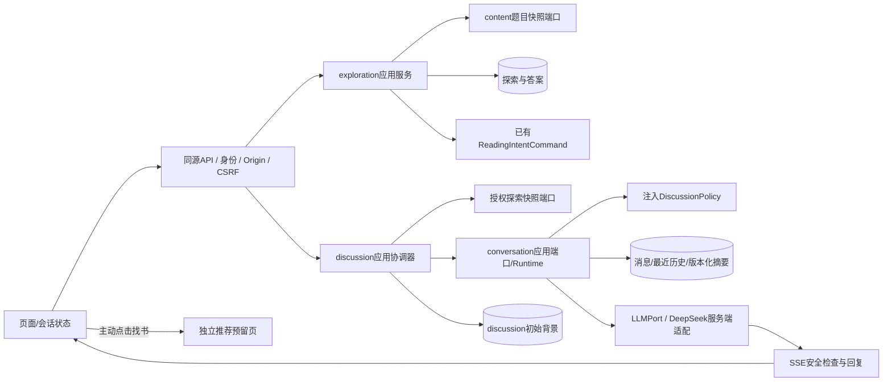

# P1 修订交付：立场、理由与持续讨论

日期：2026-10-27。分支 `feat/p1-daily-exploration`；PR [#3](https://github.com/wangzi1234567m-cpu/wenyushu/pull/3)。实现提交 `4083983c0b174cb615a1aa251562bc01d475dafb`，其后补充本交付证据的提交见PR。P0 已验收合并；P1 保持草稿，等待用户人工验收，不合并 main、不打 Tag、不部署生产。

## 当前行为与数据流

今日问题 → 选立场 → 多选理由/可选300字符补充 → 自动进入持续讨论。示例题为“假如你有超能力，可以让你爱的人也爱你，你要不要使用这项超能力？”。支持、反对、尚未确定分别进入理由步骤。理由为编辑转述，附[公开辩论文字实录](https://debatetimer.cn/record/66a0f2c5a92f8e067c57d797)链接，不冒充辩手原话或节目官方材料。



API 不调用数据库仓储；应用层通过 Protocol 和显式装配使用适配器。conversation 不引用探索私表或推荐模块，DiscussionPolicy 不依赖 reading/catalog/handoff。探索沿用既有幂等意图创建；聊天本身不创建新意图、推荐或检索任务。旧版推荐接口保留兼容回归，新页面不调用它。

DeepSeek 采用[官方 Chat Completions](https://api-docs.deepseek.com/api/create-chat-completion/)服务端 HTTP 适配，明确关闭 thinking，只转发公开回复内容。正常结束才标 completed；中断标 failed。重复已完成消息复用保存的回复，不重复调用模型；失败重试使用原消息标识，较旧失败轮次在后续消息之后不允许插入重生成。

初始题目和选择固定存入 discussion.contexts。超过上下文预算或40条已完成历史消息时，压缩较旧完整轮次，保留最近轮次。摘要校验主问题、当前观点、观点变化、限定条件、未解决问题；原文不覆盖，摘要失败可恢复。失败回复及对应孤立用户轮次不当作已确认历史。

## 验收表

| 验收项 | 结果 | 实际证据 |
|---|---|---|
| 本机原生启动 | PASS | 首页、live、ready、每日题均HTTP200；最终预览切回真实DeepSeek |
| 立场/多选理由/补充 | PASS | 两步完成；唯一且规范排序的多选；单选步骤拒绝多选；非法/重复/空/超过6项拒绝；其他理由必须补充 |
| 输入边界/安全 | PASS | 保留300/301字符边界回归；消息空白/4001字符/高风险输入拒绝；Provider错误不泄密 |
| 固定版本与改答 | PASS | 旧三步版本继续使用；新版本3不覆盖旧版本；改答创建新探索，刷新可恢复 |
| 连续对话 | PASS | Mock完整链路；真实浏览器两轮DeepSeek生成及刷新后相同回复，不重复调用 |
| 身份/CSRF/Origin | PASS | 跨身份会话、探索来源、消息读写和删除拒绝；不存在和越权同404；错误CSRF和Origin拒绝 |
| 幂等/并发/失败恢复 | PASS | 同消息标识复用回复、内容冲突409；同会话只允许一轮；断开释放生成状态；过时生成不能覆盖新状态 |
| 跨模块一致性 | PASS | 背景写入失败可重复创建补齐；会话删除成功但背景清理失败，重试可完成清理 |
| 上下文与摘要 | PASS | 确定性测试覆盖观点变化、限定条件、覆盖序号及摘要失败恢复；真实JSON输出通过Pydantic校验 |
| 找书边界 | PASS | 点击仅导航预留页，返回原讨论；浏览器确认0次推荐/Handoff请求 |
| Mock及无密钥测试 | PASS | 自动化显式使用Mock与HTTP MockTransport，不读取本机.env配置来选择真实Provider |
| 分层/契约/迁移 | PASS | 架构检查、完整OpenAPI与运行路由/DTO/SSE校验；空库升级、重复升级、降级再升级、19表反射与元数据一致 |
| 前端及响应式 | PASS | lint/typecheck/build；1440px与390px浏览器10项测试；检查桌面及手机截图无水平溢出 |
| 密钥保护 | PASS | .env被Git忽略；前端静态JS及预览服务日志未包含配置的Key；不记录原始凭证或用户正文 |
| 实现提交CI | PASS | [运行40512930994](https://github.com/wangzi1234567m-cpu/wenyushu/actions/runs/40512930994)，SHA 4083983；backend/frontend/compose-browser全部success，文档补充提交的状态另见[PR当前检查](https://github.com/wangzi1234567m-cpu/wenyushu/pull/3/checks) |
| Linux Compose | PASS | 同运行实际构建镜像、空库迁移/导入、ready检查、10项浏览器测试及停止服务均success |
| Win11 Docker Compose | FAIL（本轮未验证） | 本轮使用原生PostgreSQL；上轮Docker引擎不可用，本轮不据此冒称容器启动通过 |
| 用户人工验收 | FAIL（待验收） | 以下人工步骤等待用户执行及内容审阅 |

## 实际命令与输出摘要

```text
.venv/Scripts/ruff check backend
All checks passed!
.venv/Scripts/ruff format --check backend
106 files already formatted
.venv/Scripts/python scripts/validate_contract.py
PASS: OpenAPI 21 operations; 30 schemas; 229 resolved references

TEST_DATABASE_URL=postgresql+psycopg://.../wenyushu_test
.venv/Scripts/python -m pytest backend/tests -q --tb=short
59 passed, 2 warnings in 9.76s
# 警告：Starlette测试适配弃用、本机pytest缓存权限；无测试失败。

.venv/Scripts/alembic -c backend/alembic.ini upgrade head
.venv/Scripts/python -m app.bootstrap.seed_daily --publish-current-version
Imported seven daily schedules, reviewed fallback and three sourced samples
# 开发库保留数据；只增加0003并显式将7天排期更新到新版本3。

npm --prefix web run api:generate
openapi-typescript generated schema.d.ts
cd web
npm run lint
npm run typecheck
npm run build
# 全部exit 0；首页和/recommendations生产构建完成。
npm run test:e2e
10 passed (7.6s)

HTTP / → 200
HTTP /api/v1/health/live → 200
HTTP /api/v1/health/ready → 200
HTTP /api/v1/questions/daily → 200
```

本机测试由忽略的 `.local/check_discussion.py` 启动/连接便携PostgreSQL16.15，仅使用名称以 `_test` 结尾的隔离库；不以SQLite替代。浏览器由 `.local/preview_discussion.py --mock --test` 运行，最终移除测试参数启动真实模式；这些本机辅助脚本不是项目必需入口。可复现入口为 README 的 Compose/原生启动命令及以上 pytest/Playwright 命令。

真实调用额外使用本机配置实际执行：适配器流式正常结束、结构化摘要校验、浏览器首轮、带新条件的第二轮、刷新恢复。仅发送合成测试内容，不将密钥、完整回复或用户私密信息写入交付文档。浏览器截图位于忽略目录 `web/test-results/discussion-desktop.png`、`discussion-mobile.png`；真实验证截图在 `.local/real-discussion.png`。

开发中单选 JSON null 存储曾导致数据库约束失败，已修正为 SQL NULL并重跑全套。首次幂等测试错误地要求SSE分片边界一致，已改为验证相同消息ID、最终内容和完成状态，不要求网络分片形状相同。

## 改动文件与接口/迁移

- content：flow模型、版本3开发题目与理由、最新备用版本选择；exploration：多选存储/校验、恢复标签及授权背景快照。
- conversation：application端口/Runtime、SQL仓储、消息及摘要管理；discussion：应用协调器/策略、背景表元数据及仓储。
- integrations/llm/deepseek.py、bootstrap/container.py、settings/config.py：可注入真实/Mock适配及配置；api/conversation_dto.py、api/v1/conversations.py：已有5个会话操作。
- api/daily_dto.py、dto.py、errors.py、middleware.py、v1/routes.py：新字段、统一404错误声明、SSE断开监听、路由装配。
- Alembic env.py、0003_daily_discussion.py、db/health.py、metadata.py、db/schema.sql：增量迁移与版本检查；0001/0002不变。
- web：daily/explorer.tsx、discussion/panel.tsx、recommendations/page.tsx、统一JSON/SSE客户端、生成契约类型及样式；daily.spec.ts更新为新主路径。
- tests：新增test_deepseek.py/test_discussion.py；现有配置、契约、旧版本探索、迁移测试同步。
- .env.example、infra/compose.yaml、README、SAD/DELIVERY、ADR-013及验收记录；本机.env不提交。

接口：不新造平行聊天端点，启用契约已有的POST /conversations、GET/DELETE /conversations/{id}、GET/POST /conversations/{id}/messages。ConversationCreate增可选exploration_id；Conversation增可选只读provider_mode；QuestionStep增multiple/source_url；ExplorationAnswer与恢复记录增可空option_ids。补全统一404错误响应声明。事件仍为message_started/message_delta/message_completed/message_error，字段沿用session_id，不透传reasoning。

迁移0003：新增可空content.exploration_answers.option_ids及数组数量CHECK；新增discussion.contexts，唯一conversation_id、唯一(actor_id,exploration_id)，跨模块UUID不用私表外键。空库到head、重复upgrade和可丢弃测试库降级已执行。Alembic为唯一执行路径，设计DDL仅参考。

## 人工验收步骤

1. 访问 http://localhost:3000，若保留旧探索，可点击“从今日问题重新开始”。当前题显示超能力爱情题。
2. 选择支持/反对/尚未确定，进入对应理由；勾选多个，可选补充。查看观点来源；“其他”不填写应被拒绝。
3. 完成后看到DeepSeek标识及真实回复，继续发送不同观点或改变条件。确认回复围绕题目和选择，且不将假设当现实经历。
4. 刷新，应恢复已完成消息；生成中可停止，出错可显式重试。较长对话的语义连续性还需人工评估，不由Mock测试替代。
5. 点击旁栏（手机在下方）“根据讨论推荐书”，进入独立预留页；返回后保留讨论。无书单、无检索、无推荐任务。
6. 用不同浏览器身份验证无法读取对方会话。不要将Key复制到聊天、前端或截图。

## 风险与回滚

本次只前移必要对话能力，P3整体未验收。基础文本检查覆盖有限，不是生产审核；没有完成运营举报、压测、法定手续、真实长会话质量评测。初始示例题有可查辩论实录，其他6题仍为开发编辑样例，需内容团队逐题审核及补齐依据。匿名会话默认7天有效期不代表最终数据保留政策。

基础每日轮次上限按持久消息计数，失败重试及删除后计数并非严格计费额度控制；生产前还需补齐独立调用预算及滥用防护。摘要使用UTF-8字节保守估算预算，质量与成本需后续真实长对话评估。Win11 Compose本轮未实际启动，不能由原生验证或Linux CI替代。

真实模型出现故障时，可先将本机PROVIDER切换为mock并重启后端，界面会明确显示Mock；保留会话与数据。彻底代码回滚应在功能分支revert问题提交，并保留0003迁移、健康检查迁移头和题目版本3的解析兼容代码，再通过旧版内容维护流程显式恢复版本2排期。直接恢复全部旧代码会使ready版本不匹配，也无法解析新版本题目，不能将它当作无风险回滚。已有探索的固定版本不改写。不执行reset/clean、删数据卷或生产降级。

`alembic downgrade 0002_daily_exploration` 会删除多选信息及讨论背景，**只用于明确可丢弃测试库**；运行中开发库应先备份并停止服务，未得到数据丢弃授权不执行。`.env`保留，密钥不因代码回滚写入Git。
